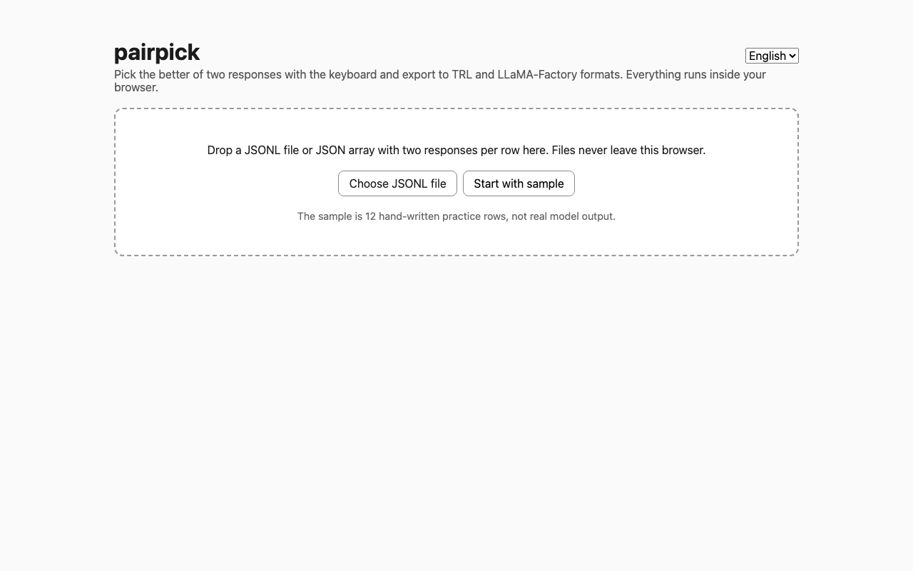
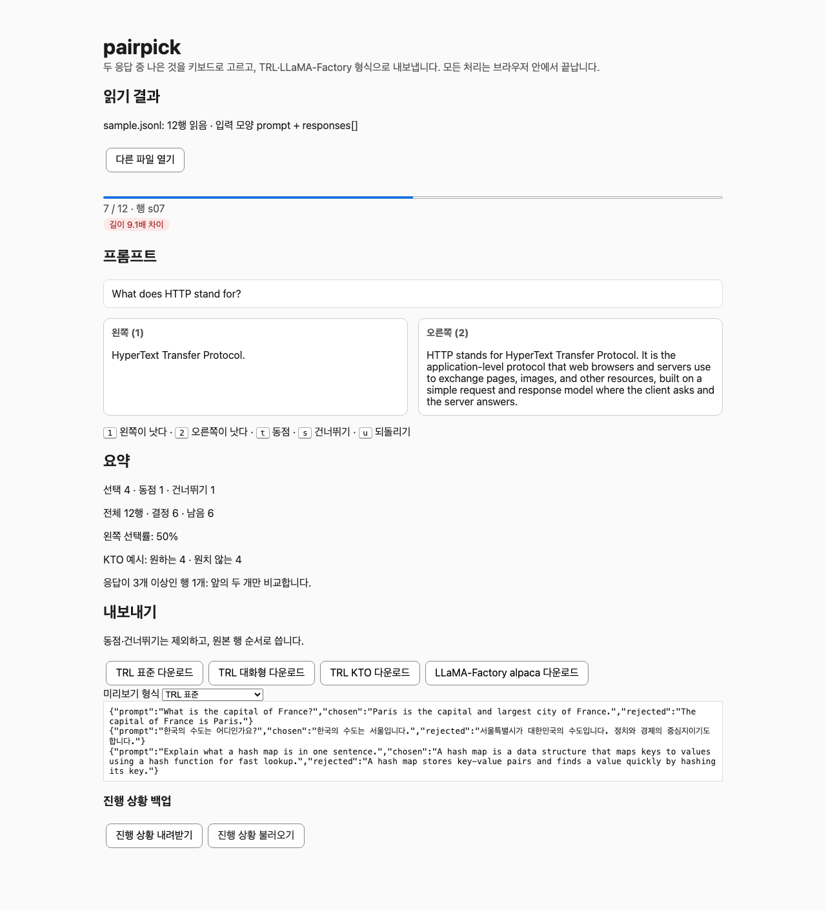
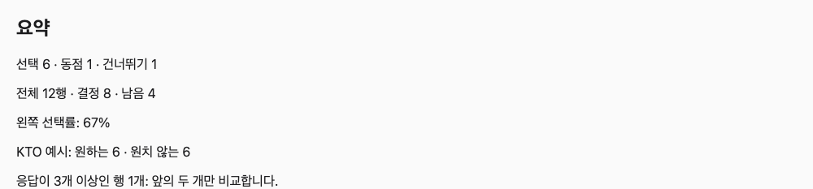
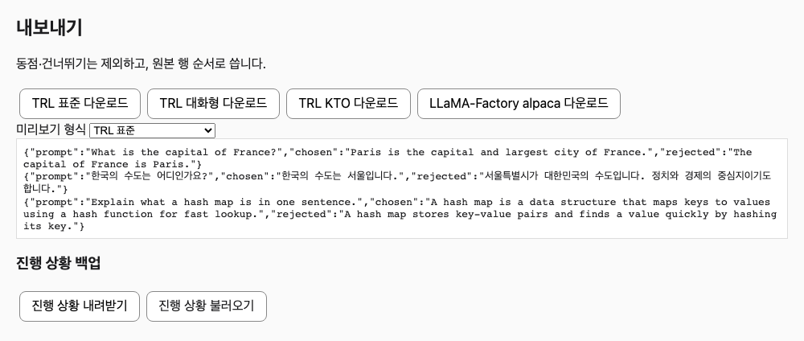
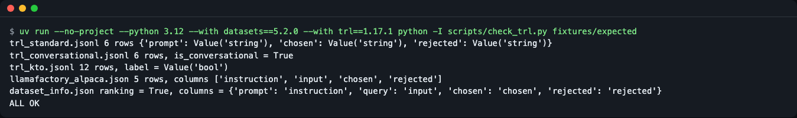
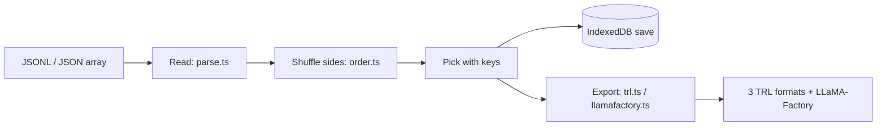

# pairpick

[한국어](README.md) | **English**

pairpick is a static web app that runs entirely in your browser: drop in a JSONL file (or a JSON array of rows) with two responses per prompt, pick the better one with the keyboard (`1` / `2`), and export preference files that TRL (DPO, KTO) and LLaMA-Factory read directly. Your data never leaves the browser, and there is no server, account, or database to set up. Run it with `npm install && npm run dev`.

Pick the better of two responses with the keyboard, and the file that DPO and KTO training frameworks read comes out right away. No labeling server and no conversion script needed.


*Start screen: the drop area for files and the "샘플로 시작" (Start with sample) button. There is no server to install.*

## What data do DPO and KTO want
- **DPO** consumes **pairs**: of two responses to the same question, the "better one (`chosen`)" and the "worse one (`rejected`)." It is like an eye exam asking "Is number 1 clearer, or number 2?"
- **KTO** needs no pairs; it only needs a "good/bad" verdict (a boolean `label`) for **each single response**. It is built by unpacking the results of picking pairs: `chosen` becomes good and `rejected` becomes bad.
- Once you pick a pair, pairpick exports both forms. The column names for each format are under "Export" below.

## Who it's for
- People who want to fine-tune a small model with DPO or KTO and **look at and pick** a few hundred to a few thousand responses by eye
- People whose data must not leave their machine, so they cannot upload files to an external service
- People who want to re-review `chosen`/`rejected` data they have already built

## Install
Node.js 22.22.2 or later (22 line), 24.15 or later (24 line), or 26 or later is required (`engines` in `package.json`). The versions checked when this was written are Node 26.13.0 and npm 11.20.0.

```bash
# If you don't have Node.js, install it from https://nodejs.org (or use a version manager such as nvm)
git clone https://github.com/LeeGyeongPil/pairpick.git
cd pairpick
npm install
```

On a minimal Linux environment, `git`, `node`, and `npm` are all you need. The app calls no external service, so no API key is needed.

## Quick start
```bash
npm run dev
```
Open the printed address (usually `http://localhost:5173`) in a browser and press **"샘플로 시작"** (Start with sample). If you have your own file (JSONL or a JSON array), drag it onto the screen or press "JSONL 파일 선택" (Choose JSONL file).

The sample is **12 rows written by hand for practice** and is not real model output. It deliberately includes identical responses, an empty response, a length difference, a duplicate prompt, a conversational prompt, and a row with 3 responses, so you can see the warning badges and all 4 export formats.


*Compare screen: left and right cards, quality warning badges, a progress bar, and the key guide at the bottom (`1` `2` `t` `s` `u`).*

How to read the screen:
1. The progress bar at the top and a number such as "3 / 12 · 행 s03" (row s03) show your current position.
2. Badges are quality warnings for this row (for example, "길이 4.2배" — length 4.2x).
3. The left and right cards are the two responses. Which response lands on the left is shuffled (see "Position bias" below).
4. Pressing a key moves straight to the next row.

For deployment, `npm run build` produces static files in `dist/`. Upload the whole folder to any static hosting (`base: './'` means it works under a subpath too).

## Usage

### Input file shape
You can feed in a file with one JSON per line (JSONL), or a JSON array containing row objects (`[ {...}, {...} ]`). If the content starts with `[` and the whole thing is a valid JSON array, it is read as an array (if the array is broken, errors are shown per line, as for JSONL). The file extension is not checked. The three shapes below are recognized automatically. A prompt is either a string or a `[{role, content}]` message list.

```jsonl
{"id":"a1","prompt":"질문","responses":["응답 1","응답 2"]}
{"id":"a2","prompt":"질문","response_a":"응답 A","response_b":"응답 B"}
{"id":"a3","prompt":"질문","chosen":"예전에 고른 답","rejected":"예전에 버린 답"}
```

A JSON array example (the same shape as `fixtures/inputs/array.json`):

```json
[
  {"id":"a1","prompt":"질문","responses":["응답 1","응답 2"]},
  {"prompt":"질문","response_a":"응답 A","response_b":"응답 B"}
]
```

- If there is no `id`, the line number (JSONL) or the item's position (JSON array, from 1) is used. Array errors are also reported as "item N." An array example is in `fixtures/inputs/array.json`. If you feed in an empty file, a whitespace-only file, or `[]`, you get a message that there are no rows to read. With 3 or more responses, only the first two are compared, and the count is shown in the summary.
- The `chosen`/`rejected` shape is **re-review mode**. The original labels are hidden on screen, and the summary shows how closely your new picks match the originals.
- A BOM, Windows line endings (CRLF), and blank lines are skipped. A broken line appears in the list in the form `3번째 줄: ...` (line 3: ...), and the remaining rows are read as usual.

### Picking with the keyboard
| Key | What it does |
|---|---|
| `1` | The left one is better |
| `2` | The right one is better |
| `t` | Tie |
| `s` | Skip |
| `u` | Undo the last decision |

Decisions are saved by the **original response number**, not by screen left or right. So even though left and right are shuffled, `chosen`/`rejected` are never swapped in the exported file.

### Quality warnings and position bias
Badges flag in advance the rows with a weak training signal. Nothing is removed automatically; the judgment is yours.
- **Identical responses**: If the two responses are the same, there is no reason to choose, so there is no training signal.
- **Empty response**: If one side is empty, the model only learns "better than nothing," which is of little use.
- **Length ratio of 3x or more**: It is easy to habitually pick the longer one, and the model may learn to prefer length itself (length bias).
- **Duplicate prompt**: If the same question appears many times, that question is over-weighted in training.

### Viewing the summary

*Summary panel: the counts of picks, ties, and skips, and the left-pick rate.*

The **left-pick rate** is "the share of times you chose the left card." Left and right are shuffled randomly, so it should be near 50%. If you have made 10 or more picks and the rate strays far from 40-60%, a position-bias warning appears on screen. For the fact that response position can affect evaluation, see the paper on position bias ([arXiv 2406.07791](https://arxiv.org/abs/2406.07791), checked 2026-11-10).

### Export

*Export panel: download buttons for the 4 formats and a preview of the first few lines.*

Ties and skips cannot form a DPO pair, so they are excluded, and the rest are written in the original row order.

| Button | File | Shape of one line (row) |
|---|---|---|
| TRL standard | `<input file name>.trl-pref.jsonl` | `{"prompt","chosen","rejected"}` strings |
| TRL conversational | `<input file name>.trl-pref-conv.jsonl` | The prompt as a user message, the responses as lists of assistant messages |
| TRL KTO | `<input file name>.trl-kto.jsonl` | `{"prompt","completion","label"}`, with `label` as a JSON boolean |
| LLaMA-Factory alpaca | `<input file name>.llamafactory-alpaca.json` + a `dataset_info.json` snippet | `instruction`, `input`, `chosen`, `rejected` |

Actual output examples (copied from the golden files in `fixtures/expected/`):

```jsonl
{"prompt":"What is the capital of France?","chosen":"The capital of France is Paris.","rejected":"Paris is the capital and largest city of France."}
```
```jsonl
{"prompt":"What is the capital of France?","completion":"The capital of France is Paris.","label":true}
{"prompt":"What is the capital of France?","completion":"Paris is the capital and largest city of France.","label":false}
```

- A multi-turn (message list) prompt is flattened into a string of `role: content` lines for TRL standard and KTO, left as is for conversational, and **excluded** from alpaca, with a note of how many rows were dropped.
- **KTO caution**: Unpacking pair decisions into KTO format makes `chosen` `true` and `rejected` `false`. But `chosen` is only the "better" answer and may not be an absolutely good one. If both answers were bad, this conversion distorts the meaning ([TRL KTO docs](https://huggingface.co/docs/trl/main/en/kto_trainer), checked 2026-11-10). The docs advise balancing with `desirable_weight` and `undesirable_weight` when the ratio of desired to undesired examples differs greatly.

### Reading it in a training framework
This is an example of reading with TRL (Hugging Face `datasets`). We actually ran the code below and checked the output (datasets 5.2.0).

```python
from datasets import load_dataset

ds = load_dataset("json", data_files="fixtures/expected/trl_standard.jsonl", split="train")
print(ds)
print(ds[0]["chosen"])
```
```text
Dataset({
    features: ['prompt', 'chosen', 'rejected'],
    num_rows: 6
})
The capital of France is Paris.
```

When using your own file, just change `data_files` to the path of the downloaded file. To pass this dataset to `DPOTrainer`/`KTOTrainer`, follow the TRL docs ([dataset formats](https://huggingface.co/docs/trl/main/en/dataset_formats)).

For LLaMA-Factory, put the downloaded alpaca file in the `data/` folder and paste the `dataset_info.json` snippet you downloaded with it into LLaMA-Factory's `data/dataset_info.json`. The column names follow the alpaca preference format in the [LLaMA-Factory data docs](https://github.com/hiyouga/LLaMA-Factory/blob/main/data/README.md) (checked 2026-11-10).

```json
{
  "<입력파일명>_preference": {
    "file_name": "<입력파일명>.llamafactory-alpaca.json",
    "ranking": true,
    "columns": { "prompt": "instruction", "query": "input", "chosen": "chosen", "rejected": "rejected" }
  }
}
```

(`<입력파일명>` means `<input file name>`.)

Whether the exported formats are really readable is checked by a verification script in the repo (HF `datasets` 5.2.0, TRL 1.17.1).

```bash
uv run --no-project --python 3.12 --with datasets==5.2.0 --with trl==1.17.1 python -I scripts/check_trl.py fixtures/expected
```

*`label` is read as `Value('bool')`, conversational rows are recognized as conversational, and the last line is `ALL OK`.*

If you don't have `uv`, install it with `curl -LsSf https://astral.sh/uv/install.sh | sh`. The first run takes tens of seconds to download packages.

### Resuming and backup
- Decisions are saved automatically to the browser's **IndexedDB**. If you feed in the same file again, you continue where you left off (a fingerprint of the file content decides whether it is the same file; BOM and line-ending differences are ignored).
- A browser may clear this storage under storage-space policies or in private mode. For important work, save with the **진행 상황 내려받기** (Download progress) button (JSON) under **진행 상황 백업** (Progress backup) in the export panel. With the same file open, uploading it with **진행 상황 불러오기** (Load progress) restores your decisions. A backup from a different file is rejected.
- If IndexedDB is unavailable, a notice banner appears at the top of the screen, and you can do the same job with the backup JSON.
- Above 20MB or 20,000 rows, a warning says the screen may become slow (it currently reads everything at once).

## Settings
There are no environment variables or config files. There are no network calls either, so no API key is needed. The practice sample data is in `src/sample/sample.jsonl`.

## How it works


1. **Read**: Reads each line (each item for a JSON array) as JSON, fits it into one of the three shapes, and collects broken lines and items with their numbers.
2. **Shuffle sides**: Decides left and right with a seed built from the file fingerprint and the row id. The same file always gets the same layout, so resuming stays consistent.
3. **Pick**: Records a decision as `original response number + the response shown on the left`.
4. **Save**: Writes to the browser's IndexedDB whenever a decision changes.
5. **Export**: Walks the decision list in original row order and builds a file per format. No values such as timestamps are inserted, so the same decisions give the same file.

Code tour:
- `src/lib/parse.ts` — reading JSONL and JSON arrays and detecting the input shape
- `src/lib/export/trl.ts`, `src/lib/export/llamafactory.ts` — format conversion (pure functions, independent of the screen)
- `src/lib/quality.ts` — the 4 quality warnings (identical responses, empty response, length ratio of 3x or more, duplicate prompt)

## When to use it
- Use it when: you want to look through and pick from a few hundred to a few thousand rows of two-response data by hand, and get the results straight in TRL or LLaMA-Factory format; or when data must not leave your computer.
- Alternatives compared (as of the 2026-11-10 survey; they may have changed since): [Label Studio](https://github.com/HumanSignal/label-studio) needs a server and a DB, and you must build the conversion into training formats yourself. [Argilla](https://github.com/argilla-io/argilla) needs a server and is announced as being in maintenance mode. feedloop (PyPI) requires you to feed in pairs through Python code, and only DPO was confirmed for export.
- Use another tool when: several people must label together with separate accounts → [Label Studio](https://github.com/HumanSignal/label-studio), [Argilla](https://github.com/argilla-io/argilla). You must handle tens of thousands of rows or more → a tool with a server (pairpick currently reads everything at once, so large files can be slow).

## Troubleshooting
| Symptom | Cause | Fix |
|---|---|---|
| `KeyError: 'chosen'` during training | TRL requires the column names `prompt`/`chosen`/`rejected` (`prompt`/`completion`/`label` for KTO) | Use the file pairpick exported as is, and check that your input's column names fit one of the three shapes above |
| Labels read strangely in KTO training | If `label` is the string `"true"` or 0/1, it is not read as a boolean | pairpick writes JSON booleans. If you edited the file by hand, use `true`/`false` |
| A row you marked as a tie is missing from the exported file | DPO can use only pairs with a winner, so ties and skips are dropped | Working as intended. The counts are in the summary panel |
| Banner "이 브라우저에서는 IndexedDB를 쓸 수 없어…" (IndexedDB cannot be used in this browser...) | Storage is unavailable, for example in private mode | Download the progress backup JSON and load it later |
| A "읽을 행이 없습니다" (no rows to read) message appears | You fed in an empty file, a whitespace-only file, or `[]` | Choose a file that contains rows again. Parser error messages are shown in English |
| Pressing the LLaMA-Factory button makes the browser ask about allowing multiple downloads | This button downloads two files in a row: the alpaca file and the `dataset_info.json` snippet | Choose allow. If a download comes up empty in some browser, try again (we have not yet checked this in real browsers) |
| Resuming did not work after reopening | The file content changed, or the browser cleared the storage | Check that it is the same file, and load the backup JSON |
| One error "the file is a single JSON object ..." | The file stores a single row object indented over several lines | Wrap the row objects in a `[ ]` array, or save one per line (JSONL) |
| A read error "찾은 키: foo, bar" (keys found: foo, bar) | The input row does not fit any of the three shapes | Check `prompt` and the response columns (`responses`, `response_a/b`, `chosen/rejected`) |
| `npm install` warning or failure | The Node version is not in the range above (22.22.2+ · 24.15+ · 26+) | Upgrade Node |

## Development and contributing
```bash
npm test        # Unit and screen tests (vitest, jsdom, fake-indexeddb)
npm run build   # Type check + static build
npm run lint    # oxlint
```
Test results (run when this was written): `Test Files 11 passed (11)`, `Tests 57 passed (57)`. To regenerate the export golden files, run `UPDATE_GOLDEN=1 npm test`.

Known limitations (0.2.0): the file button on the start screen also accepts JSON arrays but is still labeled "JSONL 파일 선택" (Choose JSONL file). Also, one id and line-number assertion in the test that checks the JSONL read result is unchanged from before (`src/lib/parse.array.test.ts`) is loose (always true), so that part is only partly protected by the existing tests. We plan to fix it in the next version.

Please leave bugs and suggestions as issues. The change log is [CHANGELOG.md](CHANGELOG.md).

## Learn more
- TRL dataset formats: https://huggingface.co/docs/trl/main/en/dataset_formats
- TRL KTO trainer: https://huggingface.co/docs/trl/main/en/kto_trainer
- LLaMA-Factory data docs: https://github.com/hiyouga/LLaMA-Factory/blob/main/data/README.md
- Position bias paper: https://arxiv.org/abs/2406.07791
- All the links above were checked on 2026-11-10.

## License
MIT. The sample data (`src/sample/sample.jsonl`) was written in this repo, so it has the same license. To report a security issue, see [SECURITY.md](SECURITY.md).
