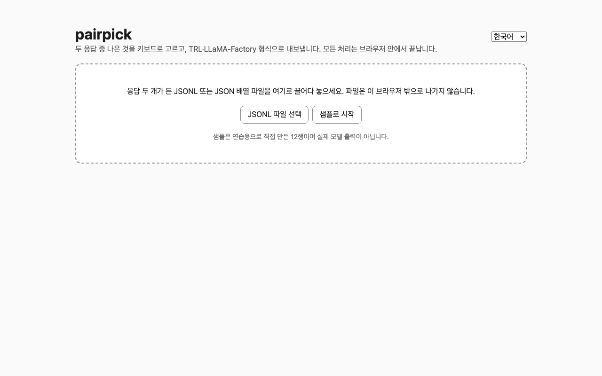
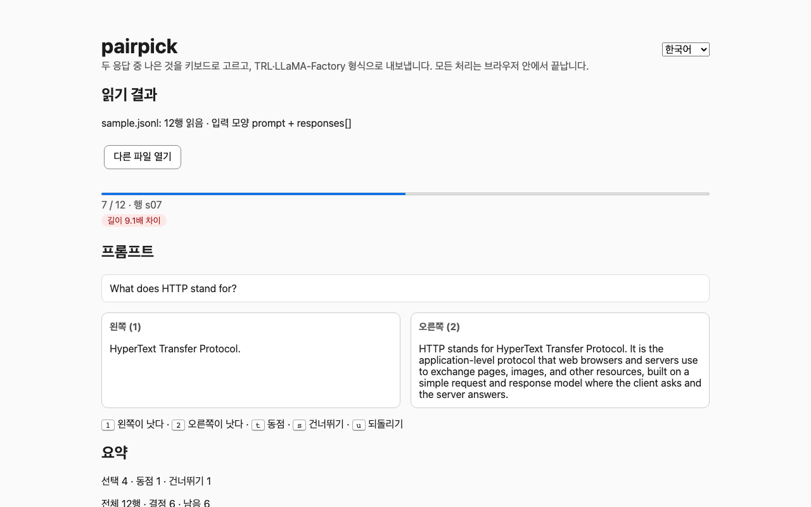
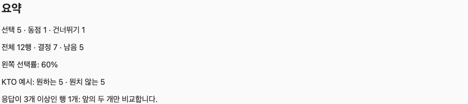
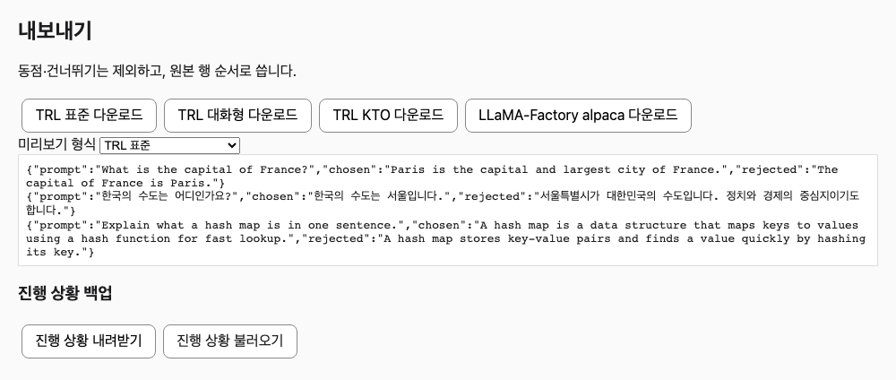
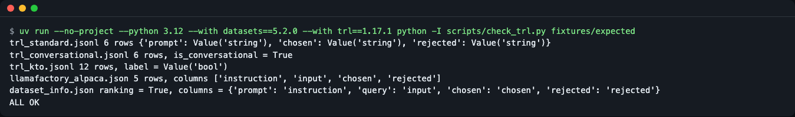
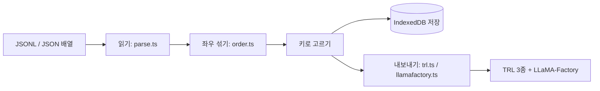

# pairpick

[English](README.md) | **한국어**

응답 두 개 중 나은 쪽을 키보드로 고르면, DPO·KTO 학습 프레임워크가 읽는 파일이 바로 나옵니다. 라벨링 서버도, 변환 스크립트도 필요 없습니다.


*시작 화면: 파일을 끌어다 놓는 영역, "샘플로 시작" 버튼, 오른쪽 위의 언어 메뉴(English / 한국어). 설치할 서버가 없습니다.*

## DPO와 KTO는 무슨 데이터를 원하나
- **DPO**는 **쌍**을 먹습니다. 같은 질문에 대한 응답 두 개 중 "더 나은 쪽(`chosen`)"과 "못한 쪽(`rejected`)"입니다. 시력 검사에서 "1번이 잘 보이나요, 2번이 잘 보이나요?"를 묻는 것과 같습니다.
- **KTO**는 쌍이 필요 없고 **응답 하나씩** "좋음/나쁨"(불리언 `label`)만 있으면 됩니다. 쌍을 고른 결과에서 `chosen`은 좋음, `rejected`는 나쁨으로 풀어서 만듭니다.
- pairpick은 쌍을 한 번 고르면 이 두 형태를 모두 내보냅니다. 형식별 열 이름은 아래 "내보내기"에 있습니다.

## 이런 분께
- 작은 모델을 DPO나 KTO로 다듬으려고, 응답 수백~수천 개를 **직접 눈으로 보고** 고르고 싶은 분
- 데이터가 밖으로 나가면 안 돼서, 파일을 외부 서비스에 올릴 수 없는 분
- 이미 만든 `chosen`/`rejected` 데이터를 다시 검토하고 싶은 분

## 설치
Node.js 22.22.2 이상(22 계열), 24.15 이상(24 계열) 또는 26 이상이 필요합니다(`package.json`의 `engines`). 이 글을 쓸 때 확인한 버전은 Node 26.13.0, npm 11.20.0입니다.

```bash
# Node.js가 없다면 https://nodejs.org 에서 설치(또는 nvm 등 버전 관리자 사용)
git clone https://github.com/LeeGyeongPil/pairpick.git
cd pairpick
npm install
```

최소 리눅스 환경에서는 `git`, `node`, `npm`만 있으면 됩니다. 앱은 외부 서비스를 부르지 않으므로 API 키가 필요 없습니다.

## 빠르게 시작하기
```bash
npm run dev
```
출력된 주소(보통 `http://localhost:5173`)를 브라우저로 열고 **"샘플로 시작"**을 누릅니다. 내 파일(JSONL 또는 JSON 배열)이 있으면 화면에 끌어다 놓거나 "JSONL 파일 선택"을 누르세요.

화면 언어는 처음에는 브라우저 언어를 따릅니다(`ko`로 시작하면 한국어, 아니면 영어). 오른쪽 위의 언어 메뉴로 언제든 바꿀 수 있습니다. [언어](#언어) 절을 보세요.

샘플은 **연습용으로 직접 만든 12행**이며 실제 모델 출력이 아닙니다. 동일 응답·빈 응답·길이 차이·중복 프롬프트·대화형 프롬프트·응답 3개 행이 일부러 들어 있어서, 경고 배지와 내보내기 4종을 모두 볼 수 있습니다.


*비교 화면: 좌우 카드, 품질 경고 배지, 진행 막대, 아래쪽 키 안내(`1` `2` `t` `s` `u`).*

화면 읽는 법:
1. 위쪽 진행 막대와 "3 / 12 · 행 s03" 같은 숫자가 지금 위치입니다.
2. 배지는 이 행의 품질 경고입니다(예: "길이 9.1배 차이").
3. 왼쪽·오른쪽 카드가 응답 두 개입니다. 어느 응답이 왼쪽에 놓이는지는 섞여 있습니다(아래 "위치 편향" 참고).
4. 키를 누르면 바로 다음 행으로 넘어갑니다.

배포용 정적 파일은 `npm run build`로 `dist/`에 만들어집니다. 폴더째 아무 정적 호스팅에 올리면 됩니다(`base: './'`라서 하위 경로에서도 동작).

## 사용법

### 입력 파일 모양
한 줄에 JSON 하나(JSONL), 또는 행 객체를 담은 JSON 배열(`[ {...}, {...} ]`) 파일을 넣을 수 있습니다. 내용이 `[`로 시작하고 전체가 올바른 JSON 배열이면 배열로 읽습니다(배열이 깨져 있으면 JSONL처럼 줄마다 오류를 보여 줍니다). 확장자는 보지 않습니다. 아래 세 모양을 자동으로 알아봅니다. 프롬프트는 문자열이거나 `[{role, content}]` 메시지 목록입니다.

```jsonl
{"id":"a1","prompt":"질문","responses":["응답 1","응답 2"]}
{"id":"a2","prompt":"질문","response_a":"응답 A","response_b":"응답 B"}
{"id":"a3","prompt":"질문","chosen":"예전에 고른 답","rejected":"예전에 버린 답"}
```

JSON 배열 예시(`fixtures/inputs/array.json`과 같은 모양):

```json
[
  {"id":"a1","prompt":"질문","responses":["응답 1","응답 2"]},
  {"prompt":"질문","response_a":"응답 A","response_b":"응답 B"}
]
```

- `id`가 없으면 줄 번호(JSONL) 또는 몇 번째 항목인지(JSON 배열, 1부터)를 씁니다. 배열 오류도 "N번째 항목"으로 알려 줍니다. 배열 예시는 `fixtures/inputs/array.json`에 있습니다. 빈 파일, 공백뿐인 파일, `[]`를 넣으면 읽을 행이 없다는 안내가 나옵니다. 응답이 3개 이상이면 앞의 두 개만 비교하고 요약에 개수를 알려 줍니다.
- `chosen`/`rejected` 모양은 **재검토 모드**입니다. 원래 라벨은 화면에 숨기고, 다시 고른 결과가 원래와 얼마나 일치하는지 요약에 보여 줍니다.
- BOM·윈도우 줄바꿈(CRLF)·빈 줄은 건너뜁니다. 깨진 줄은 `3번째 줄: ...` 형태로 목록에 뜨고, 나머지 행은 그대로 읽습니다.

### 키보드로 고르기
| 키 | 하는 일 |
|---|---|
| `1` | 왼쪽이 낫다 |
| `2` | 오른쪽이 낫다 |
| `t` | 동점 |
| `s` | 건너뛰기 |
| `u` | 마지막 결정 되돌리기 |

결정은 화면의 좌우가 아니라 **원본 응답 번호**로 저장합니다. 그래서 좌우가 섞여 있어도 내보낸 파일에서 `chosen`/`rejected`가 뒤바뀌지 않습니다.

### 품질 경고와 위치 편향
배지는 학습 신호가 약한 행을 미리 알려 줍니다. 자동으로 지우지는 않고 판단은 사람이 합니다.
- **동일 응답**: 두 응답이 같으면 고를 이유가 없어 학습 신호가 없습니다.
- **빈 응답**: 한쪽이 비어 있으면 "빈 것보다 낫다"만 배우게 되어 쓸모가 적습니다.
- **길이 비 3배 이상**: 긴 쪽을 습관적으로 고르기 쉽고, 모델이 길이 자체를 선호하도록 배울 수 있습니다(길이 편향).
- **중복 프롬프트**: 같은 질문이 여러 번 들어 있으면 특정 질문이 학습에서 과하게 반영됩니다.

### 요약 보기

*요약 패널: 선택·동점·건너뛰기 개수와 왼쪽 선택률.*

**왼쪽 선택률**은 "왼쪽 카드를 고른 비율"입니다. 좌우는 무작위로 섞어 놓았으므로 50% 근처여야 정상입니다. 10개 이상 골랐는데 40~60%를 크게 벗어나면 화면에 위치 편향 경고가 뜹니다. 응답 위치가 평가에 영향을 줄 수 있다는 점은 위치 편향을 다룬 논문([arXiv 2406.07791](https://arxiv.org/abs/2406.07791), 2026-11-10 확인)을 참고하세요.

### 내보내기

*내보내기 패널: 형식 4종 다운로드 버튼과 처음 몇 줄 미리보기.*

동점·건너뛰기는 DPO 쌍을 만들 수 없으므로 제외하고, 원본 행 순서로 씁니다.

| 버튼 | 파일 | 한 줄(행) 모양 |
|---|---|---|
| TRL 표준 | `<입력파일명>.trl-pref.jsonl` | `{"prompt","chosen","rejected"}` 문자열 |
| TRL 대화형 | `<입력파일명>.trl-pref-conv.jsonl` | 프롬프트는 user 메시지, 응답은 assistant 메시지 목록 |
| TRL KTO | `<입력파일명>.trl-kto.jsonl` | `{"prompt","completion","label"}`, `label`은 JSON 불리언 |
| LLaMA-Factory alpaca | `<입력파일명>.llamafactory-alpaca.json` + `dataset_info.json` 조각 | `instruction`, `input`, `chosen`, `rejected` |

실제 출력 예(골든 파일 `fixtures/expected/`에서 복사):

```jsonl
{"prompt":"What is the capital of France?","chosen":"The capital of France is Paris.","rejected":"Paris is the capital and largest city of France."}
```
```jsonl
{"prompt":"What is the capital of France?","completion":"The capital of France is Paris.","label":true}
{"prompt":"What is the capital of France?","completion":"Paris is the capital and largest city of France.","label":false}
```

- 여러 턴(메시지 목록) 프롬프트는 TRL 표준·KTO에서는 `role: content` 줄로 펴서 문자열로 만들고, 대화형에서는 그대로 두며, alpaca에서는 **제외**하고 몇 행을 뺐는지 알려 줍니다.
- **KTO 주의**: 쌍 결정을 KTO 형식으로 풀면 `chosen`은 `true`, `rejected`는 `false`가 됩니다. 하지만 `chosen`은 "더 나은" 답일 뿐 절대적으로 좋은 답이 아닐 수 있습니다. 두 답이 다 나빴다면 이 변환은 의미를 왜곡합니다([TRL KTO 문서](https://huggingface.co/docs/trl/main/en/kto_trainer), 2026-11-10 확인). 원하는 예와 원치 않는 예의 개수 비율이 크게 다르면 `desirable_weight`·`undesirable_weight`로 맞추라고 문서가 권합니다.

### 학습 프레임워크에서 읽기
TRL(Hugging Face `datasets`)로 읽는 예입니다. 아래 코드를 실제로 실행해 출력까지 확인했습니다(datasets 5.2.0).

```python
from datasets import load_dataset

ds = load_dataset("json", data_files="fixtures/expected/trl_standard.jsonl", split="train")
print(ds)
print(ds[0]["chosen"])
```
```text
Dataset({
    features: ['prompt', 'chosen', 'rejected'],
    num_rows: 6
})
The capital of France is Paris.
```

내 파일을 쓸 때는 `data_files`만 내려받은 파일 경로로 바꾸세요. 이 데이터셋을 `DPOTrainer`/`KTOTrainer`에 넘기는 방법은 TRL 문서([데이터셋 형식](https://huggingface.co/docs/trl/main/en/dataset_formats))를 따릅니다.

LLaMA-Factory는 내려받은 alpaca 파일을 `data/` 폴더에 두고, 함께 받은 `dataset_info.json` 조각을 LLaMA-Factory의 `data/dataset_info.json`에 붙입니다. 열 이름은 [LLaMA-Factory 데이터 문서](https://github.com/hiyouga/LLaMA-Factory/blob/main/data/README.md)(2026-11-10 확인)의 alpaca 선호 형식을 따릅니다.

```json
{
  "<입력파일명>_preference": {
    "file_name": "<입력파일명>.llamafactory-alpaca.json",
    "ranking": true,
    "columns": { "prompt": "instruction", "query": "input", "chosen": "chosen", "rejected": "rejected" }
  }
}
```

내보낸 형식이 실제로 읽히는지는 레포 안의 점검 스크립트가 확인합니다(HF `datasets` 5.2.0, TRL 1.17.1).

```bash
uv run --no-project --python 3.12 --with datasets==5.2.0 --with trl==1.17.1 python -I scripts/check_trl.py fixtures/expected
```

*`label`이 `Value('bool')`로 읽히고, 대화형 행이 대화형으로 인식되고, 마지막 줄이 `ALL OK`.*

`uv`가 없으면 `curl -LsSf https://astral.sh/uv/install.sh | sh`로 설치합니다. 처음 실행은 패키지를 받느라 수십 초 걸립니다.

### 이어하기와 백업
- 결정은 브라우저의 **IndexedDB**에 자동 저장됩니다. 같은 파일을 다시 넣으면 이어서 합니다(파일 내용의 지문으로 같은 파일인지 판단하며, BOM·줄바꿈 차이는 무시).
- 브라우저는 저장 공간 정책이나 사생활 보호 모드에서 이 저장소를 지울 수 있습니다. 중요한 작업은 내보내기 패널의 **진행 상황 백업** 아래 **진행 상황 내려받기** 버튼(JSON)으로 저장해 두세요. 같은 파일을 연 상태에서 **진행 상황 불러오기**로 올리면 결정이 복원됩니다. 다른 파일의 백업은 거부됩니다.
- IndexedDB를 쓸 수 없으면 화면 위에 안내 배너가 뜨고, 백업 JSON으로 같은 작업을 할 수 있습니다.
- 20MB 또는 2만 행을 넘으면 화면이 느려질 수 있다는 경고가 뜹니다(현재는 한 번에 읽는 방식).

## 설정

### 언어
화면은 **English**와 **한국어** 두 언어로 볼 수 있습니다.
- **메뉴**: 화면 맨 위 제목 옆, 오른쪽에 있는 언어 메뉴에서 고릅니다. 화면 전체가 바로 바뀝니다. 파일을 연 상태에서도 바꿀 수 있고, 지금까지의 결정은 그대로 남습니다.
- **브라우저에 저장**: 고른 언어는 브라우저의 `localStorage`에 키 `pairpick.lang`(`en` 또는 `ko`)으로 저장되어, 새로고침해도 유지됩니다.
- **첫 방문만 자동 감지**: 저장된 값이 없으면 브라우저 언어를 한 번 확인합니다. `ko`로 시작하는 언어(예: `ko-KR`)면 한국어, 그 밖에는 모두 영어입니다. 이 자동 선택은 저장하지 않고, 메뉴에서 고른 것만 저장하며, 저장된 선택이 브라우저 언어보다 항상 우선합니다.
- `<html lang>` 속성도 보이는 언어를 따라갑니다.
- 내보내기 파일·진행 파일·파일 이름은 언어와 무관합니다. 파서 오류 문구(예: 깨진 줄 안내)는 두 언어 모두 영어로 표시됩니다.

되돌리려면 브라우저의 사이트 데이터에서 `pairpick.lang` 항목을 지우세요.

### 그 밖의 설정
환경 변수와 설정 파일이 없습니다. 네트워크 호출도 없어서 API 키도 필요 없습니다. 연습용 샘플 데이터는 `src/sample/sample.jsonl`에 있습니다.

## 동작 원리


1. **읽기**: 한 줄씩(JSON 배열이면 항목마다) JSON으로 읽어 세 모양 중 하나로 맞추고, 깨진 줄·항목은 번호와 함께 모읍니다.
2. **좌우 섞기**: 파일 지문과 행 id로 만든 시드로 좌우를 정합니다. 같은 파일이면 항상 같은 배치라서 이어하기가 일관됩니다.
3. **고르기**: 결정을 `원본 응답 번호 + 왼쪽에 보인 응답`으로 기록합니다.
4. **저장**: 결정이 바뀔 때마다 브라우저 IndexedDB에 씁니다.
5. **내보내기**: 결정 목록을 원본 행 순서로 훑어 형식별 파일을 만듭니다. 시각 같은 값을 넣지 않아 같은 결정이면 같은 파일이 나옵니다.

코드 둘러보기:
- `src/lib/parse.ts` — JSONL·JSON 배열 읽기와 입력 모양 감지
- `src/lib/export/trl.ts`, `src/lib/export/llamafactory.ts` — 형식 변환(화면과 무관한 순수 함수)
- `src/lib/quality.ts` — 품질 경고 4종(동일 응답·빈 응답·길이 비 3배 이상·중복 프롬프트)

## 언제 쓰나
- 이럴 때: 응답 두 개짜리 데이터를 수백~수천 행 직접 보고 고르고, 결과를 TRL·LLaMA-Factory 형식으로 바로 받고 싶을 때. 데이터가 내 컴퓨터 밖으로 나가면 안 될 때.
- 비교한 대안(2026-11-10 조사 기준, 이후 바뀌었을 수 있습니다): [Label Studio](https://github.com/HumanSignal/label-studio)는 서버와 DB가 필요하고 결과를 학습 형식으로 바꾸는 변환을 따로 만들어야 합니다. [Argilla](https://github.com/argilla-io/argilla)는 서버가 필요하고 유지보수 모드로 안내됩니다. feedloop(PyPI)는 Python 코드로 쌍을 넣어야 하고 내보내기는 DPO만 확인했습니다.
- 이럴 땐 다른 도구: 여러 명이 계정을 나눠 함께 라벨링해야 한다 → [Label Studio](https://github.com/HumanSignal/label-studio), [Argilla](https://github.com/argilla-io/argilla). 수만 행 이상을 다뤄야 한다 → 서버가 있는 도구(현재 pairpick은 한 번에 읽어 오는 방식이라 큰 파일에서 느려질 수 있습니다).

## 자주 겪는 문제
| 증상 | 원인 | 해결 |
|---|---|---|
| 학습할 때 `KeyError: 'chosen'` | TRL은 열 이름이 `prompt`/`chosen`/`rejected`(KTO는 `prompt`/`completion`/`label`)여야 합니다 | pairpick이 내보낸 파일을 그대로 쓰고, 내 입력의 열 이름이 위 세 모양인지 확인 |
| KTO 학습에서 라벨이 이상하게 읽힘 | `label`이 문자열 `"true"`나 0/1이면 불리언으로 읽히지 않습니다 | pairpick은 JSON 불리언으로 씁니다. 직접 고친 파일이라면 `true`/`false`로 |
| 동점으로 고른 행이 내보낸 파일에 없음 | DPO는 우열이 있는 쌍만 쓸 수 있어서 동점·건너뛰기는 뺍니다 | 정상 동작입니다. 개수는 요약 패널에 있습니다 |
| "이 브라우저에서는 IndexedDB를 쓸 수 없어…" 배너 | 사생활 보호 모드 등으로 저장소를 쓸 수 없음 | 진행 상황 백업 JSON을 내려받아 두었다가 불러오기 |
| "읽을 행이 없습니다" 안내가 뜸 | 빈 파일, 공백뿐인 파일 또는 `[]`를 넣음 | 행이 든 파일을 다시 고르기. 파서 오류 문구는 영어로 표시됩니다 |
| LLaMA-Factory 버튼을 누르면 브라우저가 여러 파일 다운로드 허용을 물음 | 이 버튼은 alpaca 파일과 `dataset_info.json` 조각 2개를 연달아 내려받음 | 허용을 선택. 일부 브라우저에서 다운로드가 비면 다시 시도(실제 브라우저 확인은 아직 못 했습니다) |
| 다시 열었더니 이어하기가 안 됨 | 파일 내용이 바뀌었거나 브라우저가 저장소를 지움 | 같은 파일인지 확인하고, 백업 JSON을 불러오기 |
| "the file is a single JSON object ..." 오류 1개 | 행 객체 하나를 여러 줄로 들여써 저장한 파일 | 행 객체들을 `[ ]` 배열로 감싸거나, 한 줄에 하나씩(JSONL) 저장 |
| 읽기 결과에 "찾은 키: foo, bar" 오류 | 입력 행이 세 모양 중 어느 것에도 맞지 않음 | `prompt`와 응답 열(`responses`, `response_a/b`, `chosen/rejected`)을 확인 |
| `npm install` 경고·실패 | Node 버전이 위 범위(22.22.2+ · 24.15+ · 26+)에 없음 | Node 버전을 올리기 |

## 개발·기여
```bash
npm test        # 단위·화면 테스트(vitest, jsdom, fake-indexeddb)
npm run build   # 타입 검사 + 정적 빌드
npm run lint    # oxlint
```
테스트 결과(이 글을 쓸 때 실행): `Test Files 12 passed (12)`, `Tests 72 passed (72)`. Node 26 에서는 `npm test` 중 `localStorage` ExperimentalWarning 이 여러 번 출력될 수 있으며, 무해하고 테스트는 그대로 통과합니다. 내보내기 골든 파일을 다시 만들려면 `UPDATE_GOLDEN=1 npm test`.

알려진 한계(0.3.0): 시작 화면의 파일 버튼 문구는 JSON 배열도 받지만 "JSONL 파일 선택"으로 남아 있습니다. 또 JSONL 읽기 결과가 이전과 같은지 확인하는 테스트(`src/lib/parse.array.test.ts`)의 id·줄 번호 단언 하나가 느슨해서(항상 참), 그 부분은 기존 테스트가 일부 보호합니다. 다음 버전에서 고칠 예정입니다.

버그·제안은 이슈로 남겨 주세요. 변경 기록은 [CHANGELOG.md](CHANGELOG.md).

## 더 알아보기
- TRL 데이터셋 형식: https://huggingface.co/docs/trl/main/en/dataset_formats
- TRL KTO 트레이너: https://huggingface.co/docs/trl/main/en/kto_trainer
- LLaMA-Factory 데이터 문서: https://github.com/hiyouga/LLaMA-Factory/blob/main/data/README.md
- 위치 편향 논문: https://arxiv.org/abs/2406.07791
- 위 링크는 모두 2026-11-10에 확인했습니다.

## 라이선스
MIT. 샘플 데이터(`src/sample/sample.jsonl`)는 이 레포에서 직접 쓴 것이라 같은 라이선스입니다. 보안 신고 방법은 [SECURITY.md](SECURITY.md).
